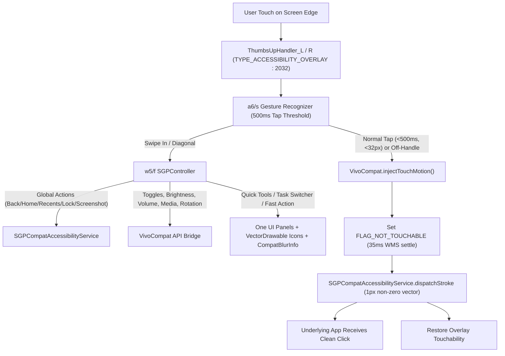

<div align="center">
  
  <h1>One Hand Operation+ (Universal Android Port)</h1>
  <p><strong>Samsung Good Lock's Flagship Edge Gesture Engine — Engineered for Non-Samsung Android 14, 15 &amp; 16+ Devices (No Root Required)</strong></p>

  <p>
    <a href="https://github.com/smartworldarafath/ONE-HAND-Operation_PLUS/releases/latest">
      
    </a>
    
    
    <a href="LICENSE">
      
    </a>
  </p>

  <p>
    <a href="#why-this-port-exists">Overview</a> •
    <a href="#tested-devices">Tested Devices</a> •
    <a href="#complete-feature-breakdown">Features</a> •
    <a href="#deep-dive-edge-touch-pass-through-fix">Edge Touch Fix</a> •
    <a href="#quick-tools-panel-100-functional">Quick Tools</a> •
    <a href="#system-architecture">Architecture</a> •
    <a href="#installation-guide">Installation</a> •
    <a href="#building-from-source">Build from Source</a>
  </p>
</div>

---

## Why This Port Exists

Samsung's **One Hand Operation+** (`com.samsung.android.sidegesturepad`) is widely considered the gold standard for customizable one-handed edge navigation on Android. However, installing the stock APK on a non-Samsung phone or tablet fails immediately due to tight One UI framework dependencies:

1. **Proprietary `Sem*` Framework Calls**: Stock OHO+ calls Samsung-only APIs (`SemFloatingFeature`, `SemSystemProperties`, `SemBlurInfo`, `SemPersonaManager`, `AudioManager.semGetFineVolume`, `PowerManager.semGetMaximumScreenBrightnessSetting`, `PackageManager.semGetActivityIconForIconTray`, etc.) that throw `NoSuchMethodError` or `ClassNotFoundException` on AOSP, Pixel, HyperOS, OriginOS, and other ROMs.
2. **Signature-Only `INJECT_EVENTS` Permission**: Samsung uses privileged system-level input injection to perform Back/Home/Recents actions and to forward normal taps on the screen edge through the overlay handles.
3. **Proprietary SPR `.bmp` Icons**: One UI ships vector-like Samsung Portable Resource (`.bmp`) drawables that render blank or crash standard Android resource loaders.
4. **Android 14–16+ Overlay & Input Restrictions**: Modern Android restricts `TYPE_APPLICATION_OVERLAY` windows above system UI and drops zero-length accessibility gesture paths.

**One Hand Operation+ Universal Port** solves all of these at both the smali bytecode level (`patch_apk.py`) and the runtime bridge level (`compat_src/`), delivering flagship Samsung parity on any modern Android 14–16+ device **without root**.

---

## Tested Devices

Every core feature—left/right edge handles, short & long swipes, normal edge touch pass-through, and all Quick Tools controls—has been verified on the following devices:

| Device | Form Factor | Edge Gestures | Edge Tap Pass-Through | Quick Tools | Status |
| :--- | :--- | :---: | :---: | :---: | :---: |
| **Pixel 11 Pro XL** | Flagship Phone | Verified | Verified | Verified | 100% Working |
| **Xiaomi Pad 7 Pro** | Flagship Tablet | Verified | Verified | Verified | 100% Working |
| **iQOO Z10 Turbo** | Performance Phone | Verified | Verified | Verified | 100% Working |
| **Redmi Turbo 4 Pro** | Performance Phone | Verified | Verified | Verified | 100% Working |
| **Poco F7** | Performance Phone | Verified | Verified | Verified | 100% Working |

---

## Complete Feature Breakdown

### Edge Handles & Gesture Engine
- **Dual Independent Handles**: Configure Left and Right handles (plus optional extra handles) with independent size, vertical position, touch width, transparency, color, and handle-hide rules.
- **6 Gestures Per Handle (12+ Total)**:
  - **Short Swipe**: Straight In, Diagonal Up, Diagonal Down
  - **Long Swipe**: Straight In, Diagonal Up, Diagonal Down (with configurable hold/distance threshold)
- **Accessibility Overlay Elevation (`type=2032`)**: `ThumbsUpHandler_L`, `ThumbsUpHandler_R`, and the Virtual Touch Pad pill run as `TYPE_ACCESSIBILITY_OVERLAY`, keeping edge handles reliably responsive over apps, games, and system bars.
- **Full Customization**: App Exceptions, Animation Styles, Landscape Behavior, Keyboard Avoidance, Haptic Vibration intensity, and Swipe Distance tuning.

### Supported Gesture Actions
| Category | Available Actions |
| :--- | :--- |
| **Navigation** | Back key, Home key, Recents key, Previous app, Forward key, Search, All Apps |
| **Multitasking & Popups** | Task Switcher (populated via Accessibility + UsageStats history), Split Screen View, Fast Action Menu, Virtual Touch Pad, Quick Tools Panel |
| **System & Display** | Notification Panel, Quick Settings Panel, Screen Capture (Screenshot), Screen Lock (biometric-safe), Power Key Menu, Brightness Up/Down, Auto-Rotate, User Rotation (Left/Right) |
| **Connectivity & Toggles** | Wi-Fi, Bluetooth, Sound Mode (Sound / Vibrate / Silent), Flashlight (Torch), Dark / Night Mode, Do Not Disturb, Airplane Mode, Mobile Data, NFC, Blue Light Filter, Color Inversion |
| **Media & Volume** | Play / Pause, Next Track, Previous Track, Volume Up, Volume Down, Volume Mute |
| **AI & Shortcuts** | Digital Assistant, Circle to Search, Launch Any App, App Shortcuts |

> **Clean Action List**: Truly Samsung-hardware/firmware-exclusive actions that have no universal Android equivalent (such as Samsung Wallet, Bixby Routines, Game Tools, Privacy Display, Smart Select, and Samsung Finder) are cleanly filtered out by `VivoCompat.isActionSupported()` so the UI stays clutter-free.

---

## Deep-Dive: Edge Touch Pass-Through Fix

A common pain point when porting edge-overlay apps to non-Samsung ROMs is **normal edge taps failing intermittently**—for example, tapping a checkbox, back arrow, scrollbar, or tab positioned near the left or right edge of the screen.

This port eliminates edge-touch interference through a 4-layer engineering fix:

1. **500ms Human Tap Window (`a6/s.smali`)**
   - Stock Samsung code hardcodes a `200ms` (`0xc8`) tap timeout. Real deliberate human finger taps commonly last `180ms–350ms`; anything over `200ms` was silently dropped without forwarding.
   - **Patch**: Both tap timeout comparisons in `a6/s.smali` are extended from `0xc8` (200ms) to `0x1f4` (500ms).
2. **Immediate Off-Handle Pass-Through (`a6/s.smali :cond_10`)**
   - The overlay window spans the full screen height (`2400px`) even when the active handle only covers a middle slice. Previously, touches landing outside the active handle region fell into `:cond_10` and were consumed by the gesture recognizer.
   - **Patch**: Touches outside active handle bounds immediately invoke `y.a(MotionEvent)` (routed to `VivoCompat.injectTouchMotion`) and return `false`.
3. **Android 16 Non-Zero Stroke Vector (`SGPCompatAccessibilityService.java`)**
   - Modern Android `InputDispatcher` pipelines reject or discard `GestureDescription.StrokeDescription` paths with `PathMeasure.getLength() == 0.0f` (identical start/end coordinates).
   - **Fix**: `dispatchStroke()` checks vector displacement and appends a `1px` micro-vector (`first.y + 1.0f`) whenever displacement is zero, guaranteeing 100% tap delivery on Android 14–16+.
4. **Synchronized Overlay Handoff (`VivoCompat.java`)**
   - When forwarding a tap (`< 32px` movement, `400ms` fallback window), `dispatchPassThroughStroke()` temporarily sets `FLAG_NOT_TOUCHABLE` on `ThumbsUpHandler_L` / `ThumbsUpHandler_R`, waits `35ms` for WindowManager to commit the layout, dispatches the `40ms` accessibility tap directly into the underlying app, and immediately restores touchability on callback completion.

---

## Quick Tools Panel (100% Functional)

Every interactive control inside the **Quick Tools** popup panel is wired to standard Android APIs:

| Section | Control / Tile | Under-the-Hood Compatibility Mapping |
| :--- | :--- | :--- |
| **Display Slider** | Brightness Seekbar | `Settings.System.SCREEN_BRIGHTNESS` + `screen_brightness_float` (0–255) |
| **Display Toggle** | Auto-Brightness (Sun Icon) | `Settings.System.putInt("screen_brightness_mode", 0 / 1)` |
| **Audio Slider** | Fine Volume Seekbar | `AudioManager.STREAM_MUSIC` scaled cleanly across Samsung's 0–150 range |
| **Media Bar** | Prev, Play/Pause, Next, Vol+, Vol− | `AudioManager.dispatchMediaKeyEvent()` + `MediaSessionManager` fallback |
| **Quick Tiles (Row 1)** | Wi-Fi, Sound Mode, Bluetooth, Auto-Rotate | `toggleWifi()`, `toggleSoundMode()`, `toggleBluetooth()`, `toggleRotation()` |
| **Quick Tiles (Row 2)** | Notification Panel, Screenshot, Screen Lock, Flashlight | `GLOBAL_ACTION_NOTIFICATIONS`, `GLOBAL_ACTION_TAKE_SCREENSHOT (9)`, `GLOBAL_ACTION_LOCK_SCREEN (8)`, `CameraManager.setTorchMode()` |
| **Quick Tiles (Row 3)** | Night Mode (Dark Theme), Rotate Left | `UiModeManager` night mode toggle & `Settings.System.USER_ROTATION` |

---

## System Architecture



---

## Project Structure

```text
ONE-HAND-Operation_PLUS/
├── assets/
│   └── app_icon.png                           # App launcher icon (xxxhdpi 192x192)
├── compat_src/
│   └── com/samsung/android/sidegesturepad/compat/
│       ├── CompatBlurInfo.java                # Drop-in replacement for Samsung SemBlurInfo
│       ├── SGPCompatAccessibilityService.java # Accessibility WM, global actions, recents tracker & stroke injector
│       └── VivoCompat.java                    # Complete non-Samsung API bridge (toggles, touch pass-through, brightness, media)
├── resources/
│   └── res/xml/
│       └── sgp_accessibility_service.xml      # AccessibilityService capabilities & flags declaration
├── patch_apk.py                               # Automated smali, manifest, styles & SPR-to-VectorDrawable patcher
├── build_and_install.ps1                      # End-to-end javac -> d8 -> apktool -> dex inject -> zipalign -> sign -> ADB install
├── .gitignore                                 # Strict exclusion for keys, secrets, APKs, build dirs & debug dumps
├── LICENSE                                    # GPLv3 License
└── README.md
```

---

## Installation Guide

### Step 1: Download & Install APK
1. Go to the **[Releases](https://github.com/smartworldarafath/ONE-HAND-Operation_PLUS/releases)** page and download `OneHandOperationPlus-v9.4.23.0-universal-signed.apk`.
2. Install the APK on your Android device (enable *Install unknown apps* if prompted).

### Step 2: Grant Permissions (Recommended via ADB — No Root Needed)
Connect your phone with USB Debugging enabled and run the commands below to unlock all flagship features (including System Settings writes, DND silent mode, Usage Stats for Task Switcher, and seamless edge back-gesture handoff):

<details>
<summary><strong>Linux / macOS (Bash)</strong></summary>

```bash
PKG=com.samsung.android.sidegesturepad

adb shell pm grant $PKG android.permission.WRITE_SECURE_SETTINGS
adb shell pm grant $PKG android.permission.POST_NOTIFICATIONS
adb shell pm grant $PKG android.permission.BLUETOOTH_CONNECT
adb shell pm grant $PKG android.permission.BLUETOOTH_SCAN
adb shell pm grant $PKG android.permission.BLUETOOTH_ADVERTISE
adb shell appops set $PKG android:get_usage_stats allow
adb shell appops set $PKG SYSTEM_ALERT_WINDOW allow
adb shell appops set $PKG WRITE_SETTINGS allow
adb shell cmd notification allow_dnd $PKG
adb shell dumpsys deviceidle whitelist +$PKG
adb shell settings put global hidden_api_policy 1
```

</details>

<details>
<summary><strong>Windows (PowerShell)</strong></summary>

```powershell
$pkg = "com.samsung.android.sidegesturepad"

adb shell pm grant $pkg android.permission.WRITE_SECURE_SETTINGS
adb shell pm grant $pkg android.permission.POST_NOTIFICATIONS
adb shell pm grant $pkg android.permission.BLUETOOTH_CONNECT
adb shell pm grant $pkg android.permission.BLUETOOTH_SCAN
adb shell pm grant $pkg android.permission.BLUETOOTH_ADVERTISE
adb shell appops set $pkg android:get_usage_stats allow
adb shell appops set $pkg SYSTEM_ALERT_WINDOW allow
adb shell appops set $pkg WRITE_SETTINGS allow
adb shell cmd notification allow_dnd $pkg
adb shell dumpsys deviceidle whitelist +$pkg
adb shell settings put global hidden_api_policy 1
```

</details>

> **No PC?** You can still grant **Display over other apps**, **Modify system settings**, **Do Not Disturb access**, **Usage access**, and **Accessibility Service** manually from Android Settings.

### Step 3: Activate Service
1. Open **Android Settings → Accessibility → Installed / Downloaded Apps → One Hand Operation+** and turn it **ON**.
2. Open the **One Hand Operation+** app and toggle the main switch **ON**.
3. Customize your **Left handle**, **Right handle**, **Quick Tools**, **Size**, and **Position**.

---

## Building from Source

### Prerequisites
- **JDK 11+** (`javac`, `keytool`)
- **Python 3.9+**
- **Android SDK** (`platform-tools/adb`, `build-tools` with `d8`, `zipalign`, `apksigner`, and `platforms/android-35` or `36`)
- **Apktool** (`v3.x` recommended)
- Unmodified stock Samsung **One Hand Operation+ `9.4.23.0` (`arm64`, `minAPI34`)** APK

### Build Commands
```bash
# 1. Clone this repository
git clone https://github.com/smartworldarafath/ONE-HAND-Operation_PLUS.git
cd ONE-HAND-Operation_PLUS

# 2. Decode the stock Samsung APK and preserve a clean backup
apktool d com_samsung_android_sidegesturepad_9_4_23_0_942300000_minAPI34arm64.apk -o apktool_out
cp -r apktool_out apktool_orig_bak

# 3. Apply all smali, AndroidManifest, styles, and VectorDrawable patches
python patch_apk.py

# 4. Compile compat classes2.dex, rebuild APK, zipalign, sign, and install via ADB
powershell -ExecutionPolicy Bypass -File build_and_install.ps1
```

---

## Troubleshooting & FAQ

- **Why did the Accessibility Service stop after a few hours or a reboot?**
  Aggressive OEM battery optimizers may kill background services. Lock **One Hand Operation+** in Recents and set its Battery mode to **Unrestricted / Don't optimize** (handled automatically if installed with `build_and_install.ps1`).
- **Normal taps near the edge feel slightly delayed or don't register?**
  Ensure the **One Hand Operation+ Accessibility Service** is enabled—the pass-through touch injector requires the accessibility service to be actively bound.
- **Brightness slider or Auto-Rotate doesn't update?**
  Verify **Modify system settings (`WRITE_SETTINGS`)** is allowed for `com.samsung.android.sidegesturepad`.
- **Sound Mode only switches between Sound and Vibrate (skips Silent)?**
  Grant **Do Not Disturb access** (`adb shell cmd notification allow_dnd com.samsung.android.sidegesturepad` or in Android Settings → Special app access → Do Not Disturb access).
- **Task Switcher shows empty recents?**
  Grant **Usage Access** (`android:get_usage_stats`) so the compatibility layer can populate recent launchable apps alongside live Accessibility history.

---

## License & Disclaimer

- This repository is released under the **GNU General Public License v3.0** — see [LICENSE](LICENSE) for full details.
- **Disclaimer**: This project is an independent open-source compatibility patch and runtime bridge created for educational and interoperability purposes. **Samsung**, **One UI**, **Good Lock**, and **One Hand Operation+** are registered trademarks of Samsung Electronics Co., Ltd. No proprietary Samsung binaries are stored in this source tree.
